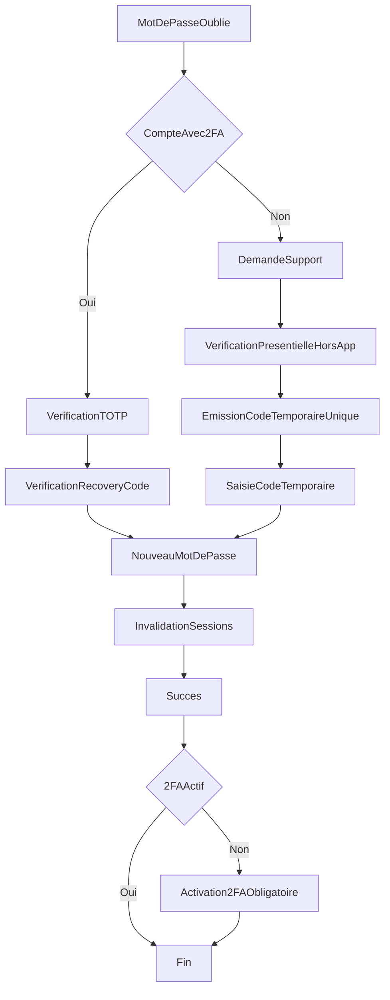

# Reset mot de passe sans email (2FA + support/admin)

Ce document définit le workflow de reinitialisation de mot de passe pour l'application, sans dependance a l'email.

Objectifs:

- proposer un parcours autonome et robuste pour les comptes avec 2FA actif;
- couvrir les comptes sans 2FA via un parcours support/admin avec verification presentielle hors application;
- eviter l'enumeration de comptes et reduire le risque de prise de compte frauduleuse.

## 1) Vue globale

## 2) Etats metier

- `password_reset_requests.status`:
  - `pending`: demande creee, en attente de verification.
  - `challenge_ready`: demande ouverte, challenge utilisateur disponible.
  - `approved_by_admin`: verification support faite, code temporaire emittable.
  - `temp_code_issued`: code temporaire emis.
  - `password_reset_done`: reset termine.
  - `rejected`: demande refusee.
  - `expired`: demande invalidee par expiration.
- `path`:
  - `twofa` (autonome utilisateur),
  - `admin` (support/admin).

## 3) UX ecran par ecran (messages exacts inclus)

### Ecran A - `Mot de passe oublie`

- **Champs**: identifiant de connexion (pseudo ou username), captcha optionnel apres seuil.
- **CTA**: `Continuer`.
- **Message de retour (toujours neutre)**:
  - `Si un compte correspondant existe, les instructions de reinitialisation ont ete preparees.`
- **Comportement**:
  - ne jamais confirmer l'existence du compte;
  - creer ou mettre a jour une `password_reset_request` interne.

### Ecran B1 - `Verification 2FA`

- **Condition d'affichage**: compte avec 2FA actif.
- **Champs**: code TOTP (6 chiffres).
- **CTA**: `Verifier le code 2FA`.
- **Erreurs**:
  - `Code invalide ou expire.` (message unique)
  - `Trop de tentatives. Reessayez dans 60 secondes.`
- **Regles**:
  - 5 tentatives max / 10 minutes;
  - backoff progressif (15s, 30s, 60s).

### Ecran B2 - `Code de recuperation`

- **Condition d'affichage**: TOTP valide.
- **Champs**: recovery code (format `XXXX-XXXX-XXXX` ou equivalent interne).
- **CTA**: `Verifier le code de recuperation`.
- **Erreurs**:
  - `Code invalide ou deja utilise.`
  - `Code expire.`
- **Regles**:
  - usage unique;
  - une verification valide consomme definitivement le code.

### Ecran C - `Nouveau mot de passe`

- **Champs**: nouveau mot de passe, confirmation.
- **Politique**:
  - minimum 12 caracteres,
  - au moins 1 majuscule, 1 minuscule, 1 chiffre, 1 caractere special,
  - refuse les 10 derniers mots de passe (si historique disponible).
- **CTA**: `Reinitialiser mon mot de passe`.
- **Succes**:
  - `Mot de passe mis a jour. Veuillez vous reconnecter.`
- **Actions serveur atomiques**:
  - hash mot de passe (`Argon2id`);
  - marquer la demande `password_reset_done`;
  - invalider toutes les sessions et refresh tokens;
  - forcer 2FA post-reset si compte non equipe (`force_enable_2fa_after_reset=true`).

### Ecran D - `Demande support` (comptes sans 2FA)

- **Condition d'affichage**: compte sans 2FA.
- **Champs**: motif court (optionnel), disponibilite pour appel.
- **CTA**: `Ouvrir une demande`.
- **Message**:
  - `Votre demande a ete enregistree. Une verification d'identite en presentiel est necessaire avant emission d'un code temporaire.`
- **Comportement**:
  - creation ticket avec `status=pending`.

### Ecran E - `Statut de la demande`

- **Elements**: numero ticket, statut (`en attente`, `valide`, `refuse`, `expire`), prochaine action.
- **Texte standard**:
  - `Un agent support vous remettra un code temporaire par telephone apres verification.`

### Ecran F - `Saisie code temporaire support`

- **Condition d'affichage**: demande admin approuvee + code emis.
- **Champ**: code temporaire.
- **CTA**: `Valider le code`.
- **Erreurs**:
  - `Code temporaire invalide.`
  - `Code temporaire expire.`
- **Regles**:
  - TTL 15 a 30 minutes;
  - 3 tentatives max avant verrouillage de la demande.

### Ecran G - `Activation 2FA obligatoire`

- **Condition d'affichage**: connexion post-reset, compte sans 2FA.
- **Contenu**:
  - setup TOTP (QR + cle secrete masquee),
  - verification TOTP immediate,
  - generation et affichage des recovery codes.
- **Blocage**:
  - pas d'acces aux ecrans sensibles tant que la 2FA n'est pas finalisee.

## 4) Contrats API (proposes)

### Public / Auth

- `POST /auth/forgot-password`
  - body: `{ "login": "string" }`
  - response 200: `{ "message": "neutral_message", "request_id": "uuid" }`
  - note: `request_id` peut etre un identifiant opaque non enumerable.

- `POST /auth/reset/verify-2fa`
  - body: `{ "request_id": "uuid", "totp_code": "string" }`
  - 204 on success, 400 invalid, 429 throttled.

- `POST /auth/reset/verify-recovery-code`
  - body: `{ "request_id": "uuid", "recovery_code": "string" }`
  - 204 on success, 400 invalid/used/expired.

- `POST /auth/reset/verify-temp-code`
  - body: `{ "request_id": "uuid", "temp_code": "string" }`
  - 204 on success, 400 invalid/expired, 429 too many attempts.

- `POST /auth/reset-password`
  - body: `{ "request_id": "uuid", "new_password": "string" }`
  - 204 on success, 400 policy violation, 409 invalid state.

### Support/Admin

- `POST /support/password-reset-request`
  - body: `{ "login": "string", "reason": "string|null" }`
  - 201: `{ "ticket_id": "uuid", "status": "pending" }`

- `POST /admin/password-reset/:requestId/approve`
  - body: `{ "verification_method": "in_person", "notes": "string" }`
  - 204 on success.

- `POST /admin/password-reset/:requestId/issue-temp-code`
  - body: `{ "ttl_minutes": 15 }`
  - 201: `{ "expires_at": "iso8601", "delivery_channel": "manual_phone" }`
  - le code brut n'est affiche qu'une fois a l'agent support.

## 5) Regles de securite transverses

- reponse neutre sur `forgot-password` pour anti-enumeration;
- hash obligatoire de tous les codes (`recovery`, `temp_code`) avec pepper serveur optionnel;
- jamais de secret en clair dans les logs;
- invalidation globale de session apres reset;
- limitation de debit:
  - par IP, par compte, par `request_id`, par endpoint;
- audit obligatoire de chaque etape sensible.

## 6) Modele de donnees cible

### Table `password_reset_requests`

- `id` (uuid, pk)
- `site_user_id` (fk)
- `path` (`twofa` | `admin`)
- `status` (`pending` | `challenge_ready` | `approved_by_admin` | `temp_code_issued` | `password_reset_done` | `rejected` | `expired`)
- `attempt_count` (int)
- `last_attempt_at` (timestamp)
- `approved_by_admin_user_id` (nullable fk)
- `expires_at` (timestamp)
- `created_at`, `updated_at`, `resolved_at` (timestamps)

### Table `temporary_recovery_codes`

- `id` (uuid, pk)
- `password_reset_request_id` (fk)
- `code_hash` (text)
- `issued_by_admin_user_id` (fk)
- `delivery_channel` (`manual_phone`)
- `expires_at` (timestamp)
- `used_at` (timestamp nullable)
- `created_at` (timestamp)

### Table `recovery_codes`

- `id` (uuid, pk)
- `site_user_id` (fk)
- `code_hash` (text)
- `batch_id` (uuid)
- `used_at` (timestamp nullable)
- `created_at` (timestamp)

### Table `security_audit_events`

- `id` (uuid, pk)
- `event_type` (text)
- `actor_type` (`user` | `admin` | `system`)
- `actor_id` (nullable)
- `request_id` (nullable)
- `ticket_id` (nullable)
- `ip_address`, `user_agent` (nullable)
- `metadata_json` (jsonb)
- `created_at` (timestamp)

### Extension `users` / `site_users`

- `twofa_enabled` (bool)
- `twofa_secret_encrypted` (nullable)
- `force_enable_2fa_after_reset` (bool default false)
- `twofa_enforced_at` (timestamp nullable)

## 7) Runbook support/admin (hors app inclus)

### SOP-01 Reception demande

- verifier ticket et identifiant;
- basculer statut `pending -> under_review`;
- planifier verification presentielle.

### SOP-02 Verification presentielle

- verifier physiquement la personne (piece + correspondance profil interne);
- valider la checklist hors app;
- en cas de doute: `reject` et escalade manager.

### SOP-03 Emission code temporaire

- admin approuve la demande;
- admin emet le code temporaire (TTL 15 min par defaut);
- support communique le code par telephone a l'utilisateur;
- support ne conserve jamais le code dans un document persistant.

### SOP-04 Cloture et controle

- apres reset reussi: verifier `password_reset_done`;
- verifier flag `force_enable_2fa_after_reset` si compte sans 2FA;
- cloturer ticket avec motif et horodatage.

### SOP-05 Gestion incidents

- si suspicion takeover: verrouiller compte, invalider sessions, escalader securite;
- si code emis par erreur: expirer immediatement la demande et tracer l'incident;
- extraire l'audit trail complet pour investigation.

## 8) Plan de test

- tests API:
  - reponse neutre `forgot-password` pour compte existant/non existant;
  - transitions d'etat valides et rejet des transitions invalides;
  - invalidation sessions apres reset.
- tests securite:
  - brute force (TOTP, recovery, temp code) -> 429;
  - code expire/usage unique;
  - verification que les logs ne contiennent aucun code brut.
- tests UX:
  - messages d'erreur unifies;
  - blocage ecran `Activation 2FA obligatoire` tant que non finalise.

## 9) Checklist go-live

- migration DB appliquee et indexes verifies (`status`, `expires_at`, `site_user_id`);
- variables de securite configurees (pepper, rate limits, retention logs);
- formation support sur SOP-01..05;
- runbook incident partage avec astreinte;
- monitoring (taux echec reset, volume tickets admin, lockouts) active.

Documents associes:

- `docs/password-reset-support-runbook.md`
- `docs/security-manual-checklist.md` (section `sec-13`)
