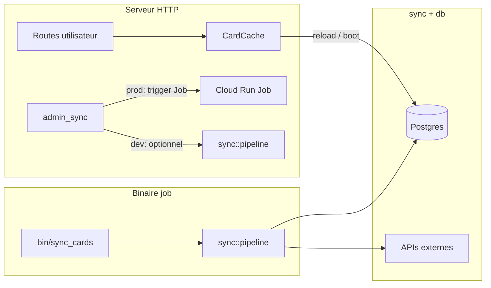

# Pipeline sync cartes — Cloud Job vs serveur HTTP

**Statut** : cible d’architecture (référence pour refactors futurs).  
**Lié** : [`decisions.md`](./decisions.md) — entrée « Sync cartes (Cloud Job) ».

## Objectif

Tout ce qui **récupère les cartes et leurs infos** depuis les APIs externes et alimente la base doit vivre dans un **job** (ex. Cloud Run Job + Scheduler), pas dans le chemin critique du serveur HTTP.

Le serveur HTTP sert le trafic utilisateur, le **cache runtime** (`CardCache`) et les lectures DB « produit » ; la **vérité persistée** des cartes est maintenue par le job.

## Rôles

| Entrée | Rôle |
|--------|------|
| **`main` (serveur HTTP)** | Requêtes utilisateurs, sessions, cache mémoire, lectures DB. En **prod**, ne doit pas porter le gros sync cartes (sauf garde-fous / dev). |
| **Binaire `job`** (ex. `src/bin/sync_cards.rs`) | **Orchestrateur** du pipeline : YGOProDeck → DB → enrichissements (YGOrg, etc.) → sortie / logs. Point d’entrée Cloud Run Job ou cron. |
| **Routes `admin_sync` (HTTP)** | **Optionnelles en prod** : déclencher le job (API GCP, Pub/Sub, queue) plutôt que ré-exécuter tout le SQL inline. En **dev**, peuvent déléguer au même `sync::pipeline` derrière `ADMIN_SECRET`. |

## Structure de fichiers cible (à converger progressivement)

```text
src/
  lib.rs
  main.rs                         # bin serveur HTTP uniquement
  bin/
    sync_cards.rs                 # (ou job.rs) : tokio::main → pipeline
  sync/                           # nom possible : ingestion, pipeline, jobs
    mod.rs
    pipeline.rs                   # ordre unique des étapes (run)
    ygoprodeck.rs                 # glue cards_sync / ygo_api → DB
    ygorg_enrich.rs               # glue ygorganization pour le pipeline
  db/                             # SQL bas niveau (inchangé dans l’esprit)
  cards_sync.rs                   # peut migrer sous sync/ plus tard
  ygorganization.rs               # idem
  modules/
    admin_sync/
      routes.rs                   # mince : trigger job ou pipeline (dev)
```

Les noms `sync/` vs `ingestion/` sont interchangeables ; l’important est **un seul module d’orchestration** appelé par le job (et éventuellement par l’admin en dev).

## Qui appelle quoi



1. **`bin/sync_cards`** : `sync::pipeline::run(&config, &pool).await` → code de sortie selon succès / échec.
2. **`sync::pipeline`** : enchaîne migrations (si politique = job), `cards_sync`, écritures DB, enrichissements YGOrg, etc. **Une seule définition** de l’ordre des étapes.
3. **`main`** : au démarrage, chargement cache depuis DB (ou fichier) comme aujourd’hui ; pas d’obligation d’exécuter le pipeline complet à chaque boot en prod.
4. **`admin_sync`** : prod → déclenchement distant du job ; dev → optionnellement `pipeline::run` direct pour itérer vite.

## Invariants

- **Une** fonction de haut niveau (`sync::pipeline::run` ou équivalent) pour le job (et l’admin dev si conservé).
- **Pas de duplication** du gros sync dans les routes : uniquement orchestration / trigger HTTP.
- **Job** = source de vérité **persistée** (DB) pour les données cartes synchronisées.
- **Serveur** = **cache runtime** + lectures ; rechargement cache : redémarrage, endpoint admin interne type `reload_cache_from_db`, ou mécanisme externe (rare).

## Migration depuis l’état actuel

- Aujourd’hui : `fetch_cards`, `reload_cache_from_db`, `enrich_ygorganization` dans `modules/admin_sync` appellent directement `cards_sync`, `db`, `ygorganization`.
- Cible : extraire l’ordre et la logique commune dans `sync::pipeline` ; le job binaire devient le chemin principal en prod ; les routes admin se réduisent ou délèguent au job.

Aucune échéance imposée ici : découpage par **slices** avec tests / parité comportementale, comme pour le reste du projet.
